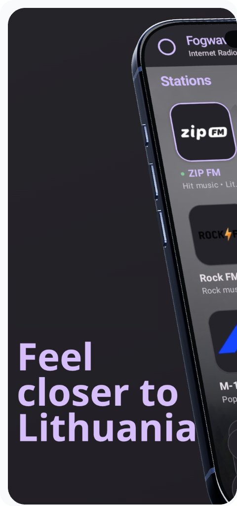
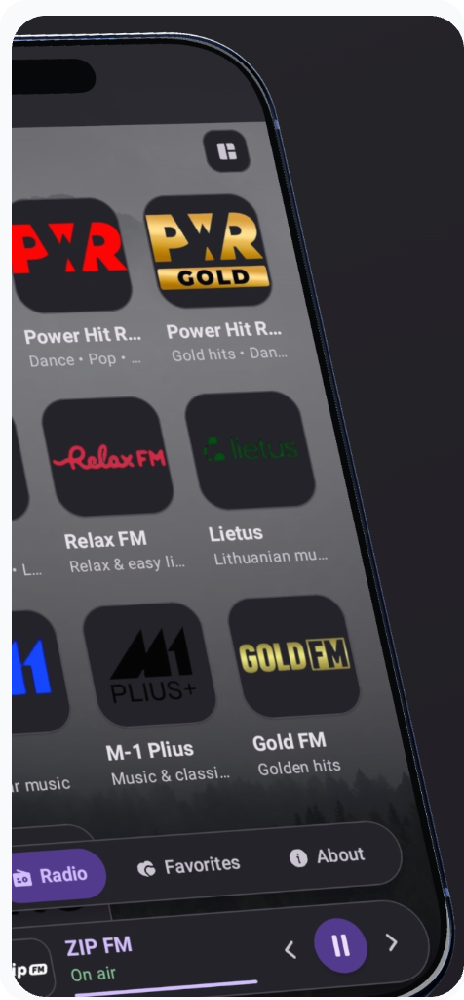
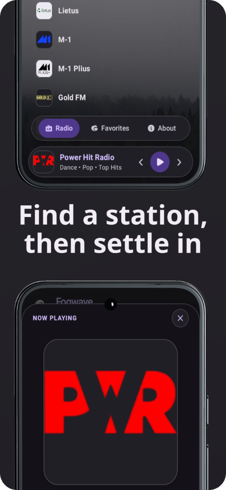
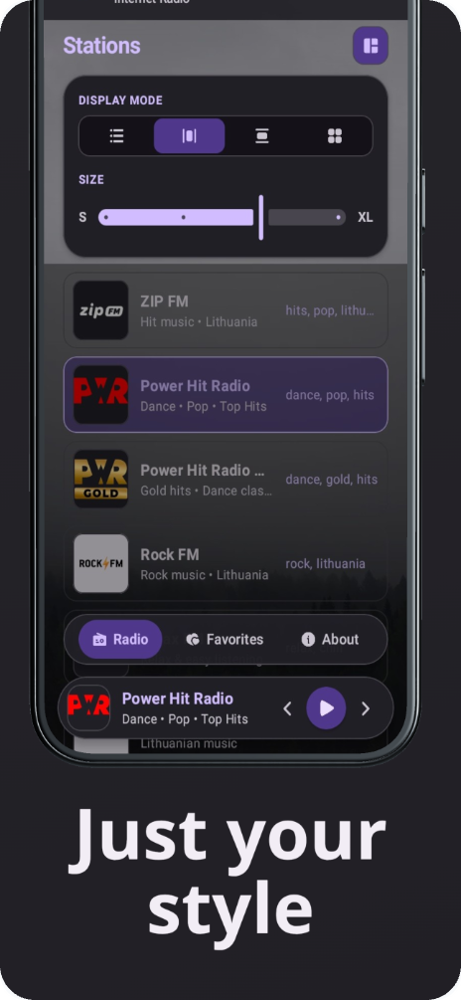
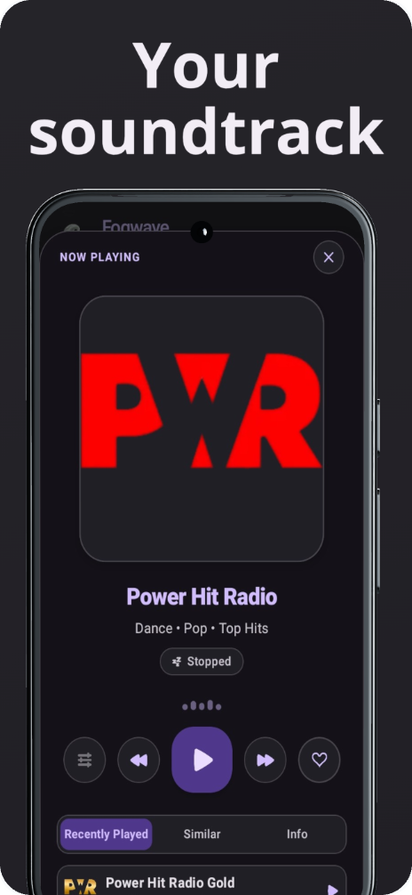
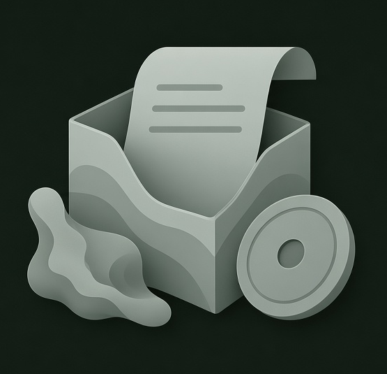
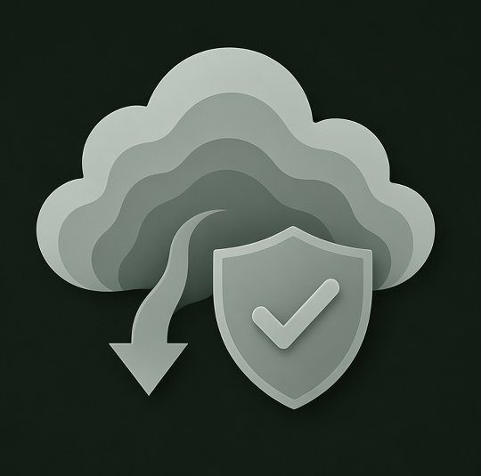
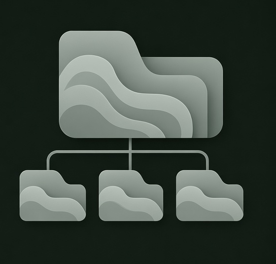

<p align="center">
  
</p>

<h1 align="center">Fogwave</h1>

<p align="center">
  <b>A calm, open-source internet radio app for Android.</b><br>
  Listen to Lithuania's favorite stations in one tap.
</p>

<p align="center">
  <a href="https://github.com/kalarina-bit/Fogwave/releases/latest"></a>
</p>

<p align="center">
  <a href="https://f-droid.org/packages/cc.skysparkle.fogwave/"></a>
  <a href="https://apps.obtainium.imranr.dev/redirect?r=obtainium://add/https://git.skysparkle.cc/kalarina/Fogwave"></a>
  <a href="https://github.com/kalarina-bit/Fogwave/releases/latest"></a>
  <a href="https://git.skysparkle.cc/kalarina/Fogwave/releases"></a>
</p>

<p align="center">
  
  
  
  
  
</p>

## ✨ Features

- 📻 **10 Lithuanian stations** — ZIP FM, Power Hit Radio, Rock FM, Relax FM, M-1, Gold FM and more
- 🎧 **Background playback** with lock-screen, notification, headphone and Bluetooth controls
- 🚗 **Android Auto** support
- 🔄 **Auto-reconnect** when the stream drops or the network comes back
- 🎚️ **Equalizer** with presets, loudness boost and dynamics processing
- ❤️ **Favorites, recently played and similar stations** matched by genre
- 🗂️ **Four layouts** — list, table, tiles or icons, with adjustable size
- 🌙 **Dark theme**
- 🌍 **Six languages** — English, Russian, German, Japanese, Lithuanian and Chinese
- 🔓 **No ads, no tracking, no accounts**

##  Installation

- **[F-Droid](https://f-droid.org/packages/cc.skysparkle.fogwave/)** — install and update through the F-Droid client.
- **[Obtainium](https://apps.obtainium.imranr.dev/redirect?r=obtainium://add/https://git.skysparkle.cc/kalarina/Fogwave)** — installs the APK straight from Gitea releases and keeps it up to date.
- **Manually** — download the latest APK from [GitHub](https://github.com/kalarina-bit/Fogwave/releases/latest) or [Gitea](https://git.skysparkle.cc/kalarina/Fogwave/releases), allow installs from unknown sources for the app you open it with (Settings → Apps → Special access → Install unknown apps), then open the `.apk` and confirm.

##  Verifying a download

Every official APK is signed with the same key. Check it before installing:

```sh
apksigner verify --print-certs Fogwave-v<version>.apk
```

The SHA-256 fingerprint of the signing certificate must be:

```
1A:85:AF:5A:08:23:DE:D1:76:7C:07:55:41:FA:15:87:7F:6E:3B:99:9E:5E:52:CF:2B:C8:03:55:F6:63:12:7F
```

`apksigner` prints the same value in lowercase without colons. On Android you can check it with [AppVerifier](https://github.com/soupslurpr/AppVerifier) (app ID `cc.skysparkle.fogwave`).

##  Building from source

Requires JDK 17+ and Android SDK 37.

```sh
./gradlew assembleDebug
```

Release builds are signed only when a keystore is supplied through the `KEYSTORE_PATH`, `STORE_PASSWORD`, `KEY_ALIAS` and `KEY_PASSWORD` environment variables; otherwise the release build is unsigned, as F-Droid expects. Never commit keystores.

### Releasing

1. Bump `versionCode` and `versionName` in `app/build.gradle.kts`.
2. Add `fastlane/metadata/android/<locale>/changelogs/<versionCode>.txt`.
3. Tag the commit as `v<versionName>` (for example `v1.0.11`).

## 🤝 Contributing

Bug reports, station suggestions, translation fixes and pull requests are welcome in the [issue tracker](https://git.skysparkle.cc/kalarina/Fogwave/issues). Please read [CONTRIBUTING.md](CONTRIBUTING.md) first — it explains what fits the project and how to send changes. To open an issue or a pull request, [create an account](https://git.skysparkle.cc/user/sign_up) on this Gitea.

## 📄 License

[GNU General Public License v3.0 only](LICENSE).
